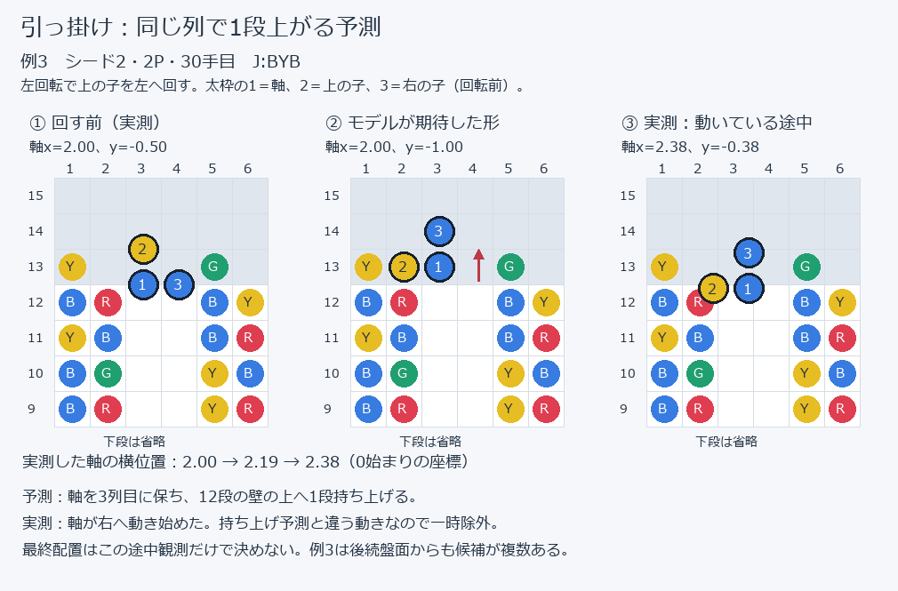
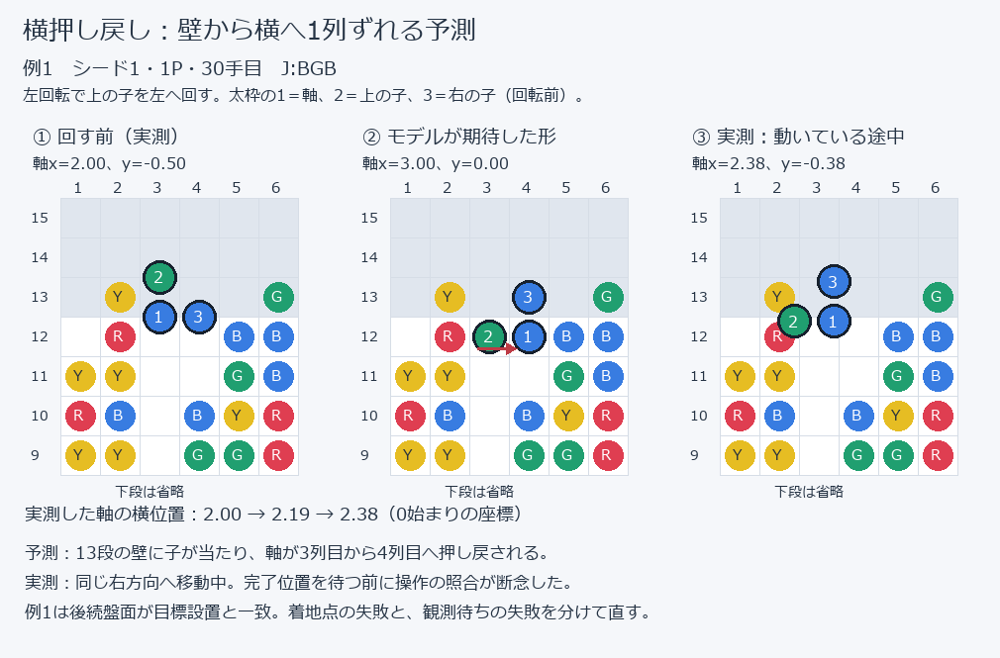

# 3個組の操作制限と操作処理のプログラム

`fever/operation_suspensions.h` の3つのフラグは経路モデル（`core/operation.*`）の入力辺だけを止める。経路モデルが届かない目標は、ゲームの操作処理のプログラムで置けるときに候補へ戻す（下記）。つまり動き自体は復活していて、止めているのは経路モデルの誤った辺だけ。

## 経路モデルで止めている辺

| 条件 | フラグ | 現行の扱い |
| --- | --- | --- |
| 12段の列へ引っ掛けて軸を13段へ上げる | `triple_hooks_enabled` | false |
| 出現高さ以上で12段以上の列に当たり横へ押し戻す | `triple_high_lateral_kicks_enabled` | false |
| スポーン行からの汎用持ち上げ | `triple_spawn_row_lifts_enabled` | false。測定済み条件の目標は許可（下記） |

左右反転も止める。普通の回転、盤面端だけの押し戻し、低い床蹴り、2個組は別。生成側だけで届くとした `measured_triple` の拡張で迂回させない。

## 止めた経路が失敗した理由





逆コンパイル（`F:\ghidra\PPe\PuyoPuyoChampions.c`、Steam build 15209927）の3個組の回転 `FUN_14002b9f0`（左）と `FUN_14002bdf0`（右）は左右対称ではない。向き0で左回転して左が塞がっていると、右上が空いていれば軸を上げずに右へ1列押し戻す（`FUN_14002b9f0` の `anim=0x12`）。上がるのは向き0の右回転で右が塞がり右上が空くときなどで、旧モデルはこの区別を持たなかった。

- 「引っ掛け」は、この押し戻しを軸の上昇と誤認していた。左右反転した同型は実測の裏付けがなかった。
- 「高段横押し戻し」は予測と同じ方向で、モデルは合っていた。回転アニメの途中（x=2.19、2.38）で観測と経路の姿勢を比べたため、照合が断念していた。操作の断念を実着地の失敗と同一視しない。

## ゲームの操作処理のプログラム

- 操作処理：`fever/control.*` は上記の関数群の移植で、独立シミュレーターが元ルーチンと毎フレーム照合した。
- 候補：`fever/normal_space.h` は、これから置くツモ（判断の根と `placements` の答え、`current`）について、経路モデルが届かない目標があるときだけ操作処理を動かし、プログラムがある目標を加える。2個組（`2:XY`）も同じ。探索の先の手には加えない。全段で動かした版は、おじゃまが降った後の高い盤面で判断が遅れた（初回の探索が140〜170ms、ツモが少し落ちてから操作開始、実機、2026-10-18）。
- プログラムの探索：`fever/control_moves.cpp` は、回転・横移動・その同時押しを最大12回つなぐ幅優先探索を行う。入力は押下2フレーム・解放1フレーム（測定済みプログラムと同じ）で、1フレーム押しの定型入力列（`control::explore`）は使わない。姿勢ごとに最初の到達だけを残し、開始を1・3フレーム遅らせても同じ着地になるものだけを使う。実機の盤面の測定では1盤面あたり中央値4.4ms、p90 5.9ms、最大11ms。列の高さと色の並びでキャッシュする。
- 入力：操作DLLの `ama_operation_triple_program`（2個組も受ける）が、その目標の入力（1フレーム1バイト）を返す。ブリッジは測定済みプログラムが無いとき、経路モデルに経路が無い目標と、持ち上げ・クイックターンを含む経路の目標で、それを測定済みプログラムと同じ実行器でフレームどおりに送る（ブリッジの `fever_play.controller_program`）。
- フレームの対応：ブリッジが新しいツモを出現のフレームに見たとき（y＝−0.5）、最初の押下は操作処理のフレーム1に当たる。見るのがkフレーム遅れたら、開始はフレーム1＋k（ログでは99.2％がk＝0）。

無効化：環境変数 `AMA_NO_CONTROLLER_PROGRAMS=1` でエンジンは候補を加えず、ブリッジもプログラムを使わない。測定済み許可は残る。

## 測定済みの持ち上げ許可（allow-list）

ブリッジの `measured_fever_inputs.lift_allowances()` が測定済み3個組プログラム28件の条件を作り、要求の `lift_allow` で渡す。条件はゴール軸・回転・一致列高さ・高さ上限・満杯ゴール許可。未指定・空配列ではスポーン行持ち上げを全て抑止する。`core/operation.*` の `MeasuredLift` と `set_measured_lifts` が一時許可を管理し、`piece_move.cpp` は条件一致の候補だけ追加する。`normal_space.h` のキャッシュ鍵へ許可表の世代を含める。

## 確認方法と限界

```powershell
python test/test_fever_control_replay.py
python test/test_fever_operations.py
```

`test_fever_control_replay.py` は実機の記録を移植で再生し、位置と着地を比べる。2026-10-14の押し戻し2例（`J:BYB`、`J:BGB`）と、2026-10-30の `J:BYB` の持ち上げ（19フレームの観測のうち12フレームと13段目の着地、y＝−1.0までの上昇を含む）がすべて一致した。この `J:BYB` はログでは `on_target` が false だが、次の盤面は目標どおりで、判定の誤り（下記）。`test_fever_operations.py` は、停止の根拠になった局面の目標がプログラムつきで提示されることと、プログラムなしで提示されないことを検査する。

実機の盤面（直近8セッション、高さ10以上の列がある2,058判断）に対し、経路モデルに無い候補があるのは3個組の61.6%（1判断あたり3.34手）、2個組の10.9%（0.38手）。経路モデルが届くのに操作処理が届かない目標は0。

実機（2026-11-01、2セッション1,317手、1フレーム押しの版）：目標の配置と次の盤面の照合で、通常の経路911手と測定済みレシピ46手に目標外は0、操作処理のプログラムは11手中1手が目標外、断念0。プログラムの発火4手は盤面で照合しておらず、`on_target` では目標どおり。目標外の1手（2P、`2:RG` の `2L`）は最初の回転がゲームに届かず、続く左入力は12段の壁で止まった。この手だけ最初の観測が1フレーム遅れており、押してすぐ離した可能性が高いが確定はしていない。

これを受けて押下を2フレームにした。高い盤面の2,509判断で届く目標の減りは3個組が1判断あたり0.02手（18.67→18.65）、2個組は0。2フレーム押しの版は**実機で未確認**。

- 移植は地形を静止として扱う（独立シミュレーターの `docs/OPEN_ISSUES.md` 6）。2026-10-18にほぼ満杯の盤面へおじゃま126個が落ちた直後の `L:YYY` が1回外れた。落下直後の揺れが原因とみているが未確定。
- `on_target` はプログラムの実行では姿勢の一致で判定するので、着地の直前まで回転の途中にあると false になる。実機の成否は次の盤面と目標の照合で見る。
- 測定済みの2個組プログラム `edge-column-1-down` の `2:RB` は別の失敗で、残っている。最初の左入力がゲームに効いておらず（列が1つ右にずれる）、原因は未確定。
- 独立シミュレーターの置ける手はAmaのコミット `233c60a` の写しで、今回の候補を含まない。

旧ログの基準：固定5例の全盤面・ツモ・予測・観測はローカル `data/fever/baselines/2026-10-14-disabled-triple-operations.json`、ログの3個組100局面は `2026-10-15-unreachable-placements.json`。`python tools/check_logged_unreachable.py check data/fever/baselines/2026-10-15-unreachable-placements.json` で失敗手がプログラム無しに提示されないことを検査する。
