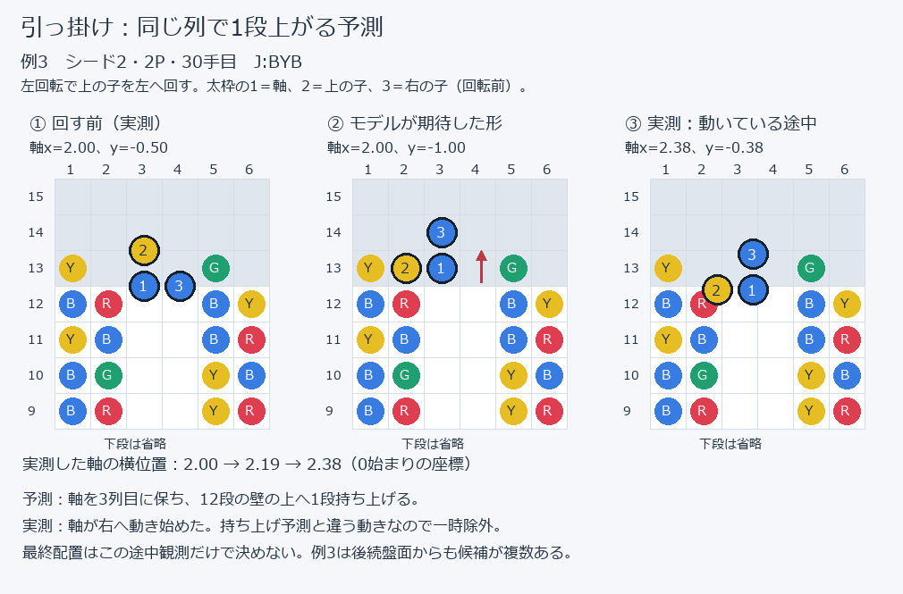
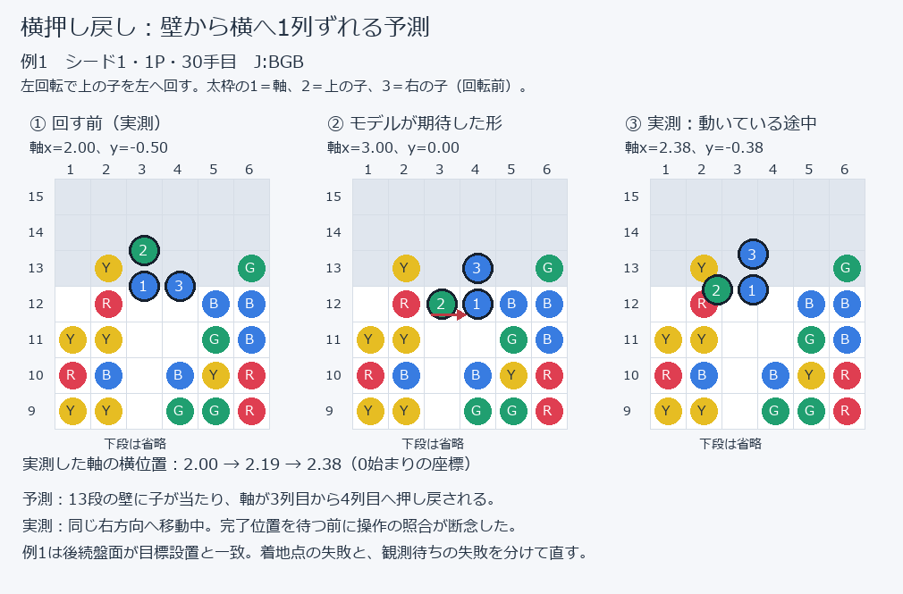
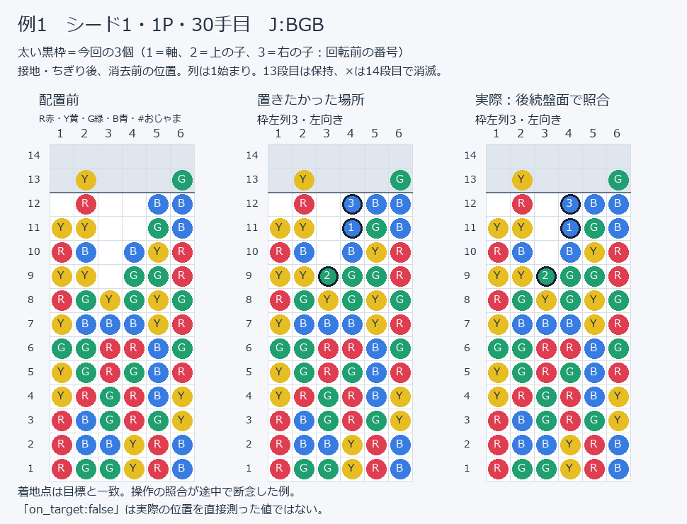
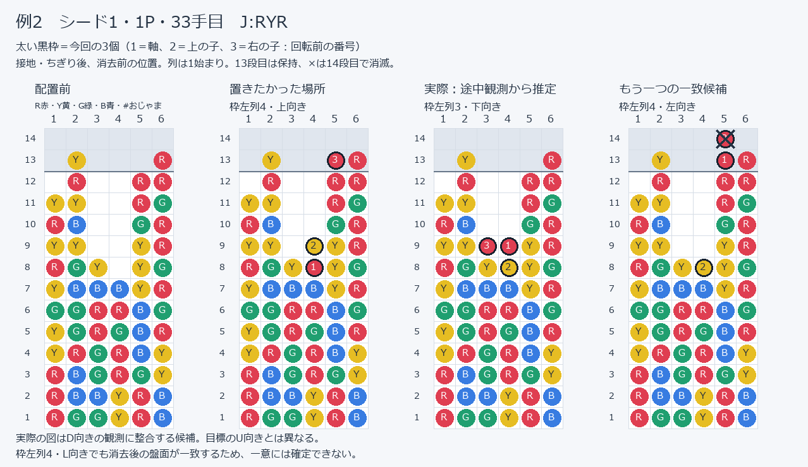
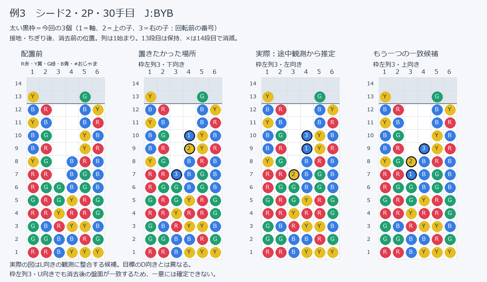
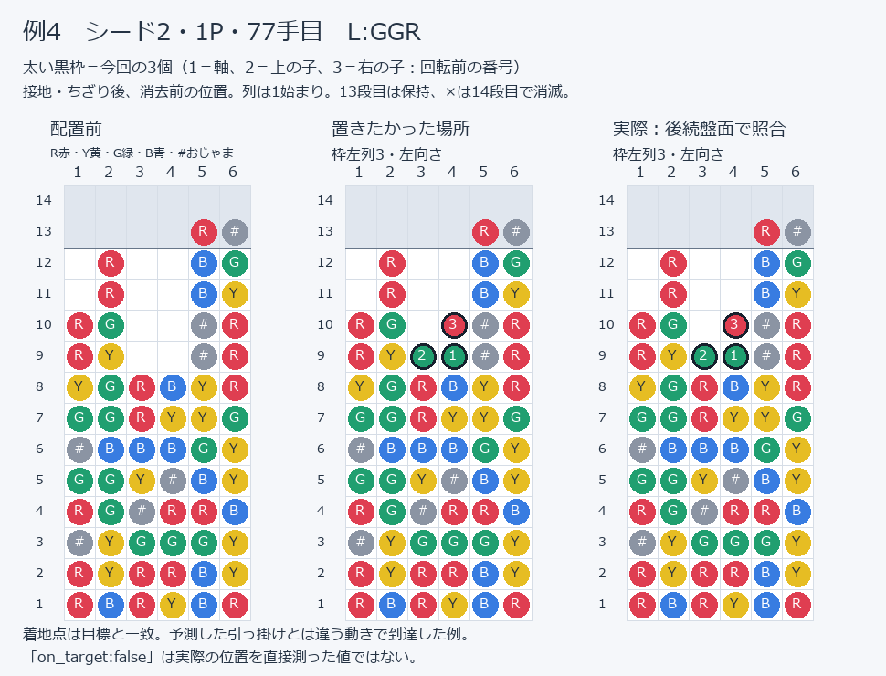
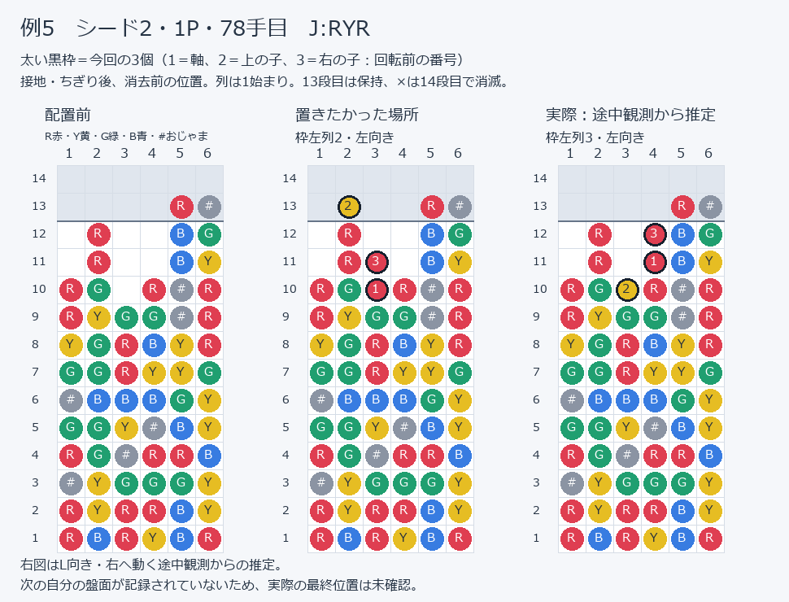

# 一時無効化した3個組の操作（2026-10-14）

変更履歴（同日・続き3）：就寝中の不具合ログ収集を目的としたユーザー指示により、T1・T2を一時的に再有効化した。修復済みという意味ではない。この再導入は次の最新指示で撤回された。反映・検証結果は `WORK_LOG.md` の後続追記を参照。

**最新の指示（同日・続き5）：上記の再導入は撤回され、T1・T2を再び除外する。** `triple_hooks_enabled` と `triple_high_lateral_kicks_enabled` はfalse。2個組の作業Aの制限も維持する。以下の図は修復用の旧モデルと観測の比較であり、有効な成功手順を保証するものではない。

ユーザー依頼により、実機で失敗した2種類の特殊回転を一時停止した。操作モデルを修復するための再現一覧。LとJは色の配置が違う同じ幾何形状なので、両方に適用する。

## 無効化した操作と範囲

| ID | 操作 | 一時停止の条件 | 実ログ例 |
| --- | --- | --- | --- |
| T1 | 12段の列へ子を引っ掛け、軸を13段へ持ち上げる回転 | 3個組の `hook`。左の1回回転と右の3回回転の両方 | 例3・4・5（左） |
| T2 | 高い列に当たった回転を、横へ1列押し戻す試作辺 | 軸y≤0、実盤面の12段以上の列への衝突により軸xが変わる3個組の回転 | 例1・2（左の壁から右へ押し戻し） |

左右反転も同じ種類として停止する。右側の失敗は今回の5件で直接測定していない。普通に空いている場所の回転、盤面の端の境界だけに当たる押し戻し、低い位置の床蹴り、2個組は停止対象外。配置全体をブラックリストにせず、この入力辺を除いたグラフで届く配置は残す。

構築・戦術の候補とDLLの経路で同じ制限を使う。ソロ構築が経路のない配置へ迂回しないよう、生成側だけの `measured_triple` 拡張も一時停止する（到達グラフで確認できる候補は維持）。

## 座標と記録の読み方

xは0始まり、yは下向きで、見える最上段が0、13段目が-1。U/R/D/Lは上/右/下/左向き。操作の姿勢は軸ぷよの `(x,y,r)`、エンジンの目標xは3個組の外接枠の左列。したがって目標 `(2,L)` の軸xは3。盤面図は14段目から最下段の順。R/Y/G/Bは色、#はおじゃま、.は空き。

出典は直近 `input-session.log`（UTF-16）の `planning` と `steering gave up.diverged.seen`。イベントは4フレーム程度の途中経過であり、解放して待ち続けた場合の最終位置を証明していない。`locked` のx/rは指定値のため実測した終点として使わない。各例の `on_target` はfalse。

シード番号はユーザーの実行順と前回比較の最初の16ツモの一致による対応（`match seed` 自体はログに無い）。全盤面・ツモ・失敗のフレーム列は `data/fever/baselines/2026-10-14-disabled-triple-operations.json` に保存した。

## 除外した操作方法の図

### T1：12段の列への引っ掛け



上向きの3個組を12段の列の隣に置き、左回転で上の子をその列へ回す。旧モデルは、子を列の上へ載せて軸を同じ列の13段目まで持ち上げる辺を許していた。例3では軸を3列目に保って上がる予測に対し、実機の軸は右へ2.19→2.38と進んだ。モデルの分岐が実機と違うため、この引っ掛け辺を除外する。

右側の試作辺も除外する。旧モデルでは上→左→下→右という左回転3回の最後で、右の12段の列へ引っ掛ける。今回の5件で直接観測したのは左側であり、右側の同じ失敗を測定したと主張しない。

### T2：高段の壁による横押し戻し



例1では、左回転で上の子を左へ回すと13段の列に当たる。旧モデルは、軸を右へ1列押し戻して左向きにする辺を許していた。実機も同じ右方向へ移動しているが、軸はまだx=2.38で、予測したx=3へ到達する前に照合が断念した。後続盤面は目標の設置と一致しており、この例を「逆方向へ回った」「必ず違う位置へ落ちた」とは扱わない。修復時は補間が終わるまで待つ処理も調べる。

除外するのは出現高さ以上で実盤面の12段以上の列に当たり、軸xが変わる試作辺。左の壁による右への押し戻しと、右の壁による左への押し戻しの両方に適用する。普通に空いた場所で回す操作、盤面端だけに当たる押し戻し、低い位置の床蹴りは残す。

## 盤面画像と着地点の訂正（2026-10-14）

図は左から配置前、狙った接地位置、実際の接地位置の照合／推定。太い黒枠の3個が今回の組ぷよ。消去前の配置を表示する。例2・3は消去後の盤面が同じになる別候補も併記した。

**操作の断念と、実際の目標外設置は別だった。** `on_target:false` は途中で制御を断念した記録で、実際の最終座標を直接測った値ではない。前項までの「目標外5回」という扱いを、次の照合結果で訂正する。一時停止の設定はこの作図依頼では変更していない。

| 例 | 照合結果 | 実際の位置の確認範囲 |
| --- | --- | --- |
| 1 | 目標の枠左列3・Lと後続盤面が一致 | 同じ配置の落下・消去を再現すると盤面全体が一致 |
| 2 | 目標の枠左列4・Uとは異なる | 枠左列3・Dと枠左列4・Lの両方が一致。途中観測はD |
| 3 | 目標の枠左列3・Dとは異なる | 枠左列3・Lと枠左列3・Uの両方が一致。途中観測はL |
| 4 | 目標の枠左列3・Lと後続盤面が一致 | 同じ配置の落下を再現すると盤面全体が一致 |
| 5 | 最終位置は未確認 | 次の自分の盤面がなく、L向きで右に動く途中観測から枠左列3・Lを推定 |

照合には停止前の `44328a8` の操作モデルを含むnativeを使用した。停止後のnativeはこの配置を意図的に拒否するため、逆算には使用していない。全図の接地セルがnativeの `locked_field` と一致し、実位置の候補は記録された消去後の盤面とも一致することを検査した。再作図は `python tools/render_disabled_triple_operations.py`（停止前nativeが必要）。

## 具体例

### 例1：T2、シード1・1P・30手目



- ツモ：`J:BGB`、可視列：`J:BGB / 0:B / 2:YB`。高さ：`[11, 13, 8, 10, 12, 13]`。
- 目標（枠左列・向き）：`(2,L)`。失敗直前の軸：`(2,0,U)`（実描画yは負の端数）。
- 失敗入力：左回転。期待：軸`(3,0,L)`。
- 観測の最後：フレーム1887、軸`[2.38, -0.38]`、向き`L`。設置の目標一致：false。
- 当初の計画：左回転。最初の左回転で失敗。

```text
......
.Y...G
.R..BB
YY..GB
RB.BYR
YY.GGR
RGYGYG
YBBBYR
GGRRBG
YGRGBR
YRGRBY
RBGRGY
RBBYRB
RGGYRB
```

| フレーム | 軸の実測(x,y) | 向き | ボタンマスク |
| ---: | --- | --- | ---: |
| 1884 | [2.0, -0.5] | U | 4096 |
| 1885 | [2.0, -0.46] | L | 4096 |
| 1886 | [2.19, -0.42] | L | 4096 |
| 1887 | [2.38, -0.38] | L | 0 |

### 例2：T2、シード1・1P・33手目



- ツモ：`J:RYR`、可視列：`J:RYR / L:GGR / 4:BBRR`。高さ：`[11, 13, 8, 7, 12, 13]`。
- 目標（枠左列・向き）：`(3,U)`。失敗直前の軸：`(2,0,R)`（実描画yは負の端数）。
- 失敗入力：右回転。期待：軸`(3,0,D)`。
- 観測の最後：フレーム2123、軸`[2.38, -0.27]`、向き`D`。設置の目標一致：false。
- 当初の計画：右回転 → 右回転 → 左回転 → 左回転。2回目の右回転で失敗。

```text
......
.Y...R
.R..RR
YY..RG
RB..GR
YY..YR
RGY.YG
YBBBYR
GGRRBG
YGRGBR
YRGRBY
RBGRGY
RBBYRB
RGGYRB
```

| フレーム | 軸の実測(x,y) | 向き | ボタンマスク |
| ---: | --- | --- | ---: |
| 2120 | [2.0, -0.38] | R | 8192 |
| 2121 | [2.0, -0.34] | D | 8192 |
| 2122 | [2.19, -0.3] | D | 8192 |
| 2123 | [2.38, -0.27] | D | 0 |

### 例3：T1、シード2・2P・30手目



- ツモ：`J:BYB`、可視列：`J:BYB / 4:GGBB / 2:BY`。高さ：`[13, 12, 6, 8, 13, 12]`。
- 目標（枠左列・向き）：`(2,D)`。失敗直前の軸：`(2,0,U)`（実描画yは負の端数）。
- 失敗入力：左回転。期待：軸`(2,-1,L)`。
- 観測の最後：フレーム1606、軸`[2.38, -0.38]`、向き`L`。設置の目標一致：false。
- 当初の計画：左回転 → 右移動 → 左回転。最初の左回転で失敗。

```text
......
Y...G.
BR..BY
YB..BR
BG..YB
BR..YR
YG.BRB
RR.BGB
RGGBGB
GRGYRG
RRYRRG
GBRYYB
GGBBRG
RRBYYY
```

| フレーム | 軸の実測(x,y) | 向き | ボタンマスク |
| ---: | --- | --- | ---: |
| 1603 | [2.0, -0.5] | U | 4096 |
| 1604 | [2.0, -0.46] | L | 4096 |
| 1605 | [2.19, -0.42] | L | 4096 |
| 1606 | [2.38, -0.38] | L | 0 |

### 例4：T1、シード2・1P・77手目



- ツモ：`L:GGR`、可視列：`L:GGR / J:RYR / 0:G`。高さ：`[10, 12, 8, 8, 13, 13]`。
- 目標（枠左列・向き）：`(2,L)`。失敗直前の軸：`(2,0,U)`（実描画yは負の端数）。
- 失敗入力：左回転。期待：軸`(2,-1,L)`。
- 観測の最後：フレーム7855、軸`[2.38, -0.38]`、向き`L`。設置の目標一致：false。
- 当初の計画：左回転 → 右移動。最初の左回転で失敗。

```text
......
....R#
.R..BG
.R..BY
RG..#R
RY..#R
YGRBYR
GGRYYG
#BBBGY
GGY#BY
RG#RRB
#YGGGY
RYRRBY
RBRYBR
```

| フレーム | 軸の実測(x,y) | 向き | ボタンマスク |
| ---: | --- | --- | ---: |
| 7852 | [2.0, -0.5] | U | 4096 |
| 7853 | [2.0, -0.46] | L | 4096 |
| 7854 | [2.19, -0.42] | L | 4096 |
| 7855 | [2.38, -0.38] | L | 0 |

### 例5：T1、シード2・1P・78手目



- ツモ：`J:RYR`、可視列：`J:RYR / 0:G / 2:BB`。高さ：`[10, 12, 9, 10, 13, 13]`。
- 目標（枠左列・向き）：`(1,L)`。失敗直前の軸：`(2,0,U)`（実描画yは負の端数）。
- 失敗入力：左回転。期待：軸`(2,-1,L)`。
- 観測の最後：フレーム7895、軸`[2.38, -0.38]`、向き`L`。設置の目標一致：false。
- 当初の計画：左回転。最初の左回転で失敗。

```text
......
....R#
.R..BG
.R..BY
RG.R#R
RYGG#R
YGRBYR
GGRYYG
#BBBGY
GGY#BY
RG#RRB
#YGGGY
RYRRBY
RBRYBR
```

| フレーム | 軸の実測(x,y) | 向き | ボタンマスク |
| ---: | --- | --- | ---: |
| 7892 | [2.0, -0.5] | U | 4096 |
| 7893 | [2.0, -0.46] | L | 4096 |
| 7894 | [2.19, -0.42] | L | 4096 |
| 7895 | [2.38, -0.38] | L | 0 |

## 直すときの確認点と再有効化

- T1：モデルは軸xを保った持ち上げを予測するが、例3〜5では軸が右へ2.19→2.38と進む。実機の押し戻しと引っ掛けの分岐条件を確認する。高さの照合を緩めて成功扱いにはしない。
- T2：予測と同じ右方向の押し戻しは始まっている。例1・2のx=2.19→2.38は、単純な「逆方向へ動いた」失敗ではない。最後まで待てばx=3になるか、実行側が補間途中で断念しているかを入力を立て直さず測定する。現ログだけで完了位置・完了フレームを断定しない。
- `core/operation.cpp` の `rotate`／`hook` と `fever/operation_suspensions.h` が操作側の入口。`core/piece_move.cpp` の `measured_triple` は生成だけの拡張の入口。修復した入力辺について、DLLの単体回転、経路、候補生成、bridgeの1回だけの計画と観測を同じ具体例で照合する。
- 現在は `triple_hooks_enabled` と `triple_high_lateral_kicks_enabled` がfalse。ログ収集用に一度両方trueへ戻したが、追加指示で再びfalseにした。再有効化すると生成側だけの古い拡張も戻るため、修復後の通常運用への復帰は、経路保証と実機確認を済ませた種類から行う。
- 単体入口：`python test/test_fever_operations.py`。失敗5例と左右反転が停止され、普通の壁回転・低い床蹴り・2個組が残る回帰を含む。再有効化時は停止の回帰を実機で確認した正しい終点・手順の回帰へ置き換える。
- 同じシードの対局で目標外・断念・大連鎖回数・判断待ちを比較する。自動テスト成功とSteamでの成功は区別する。
