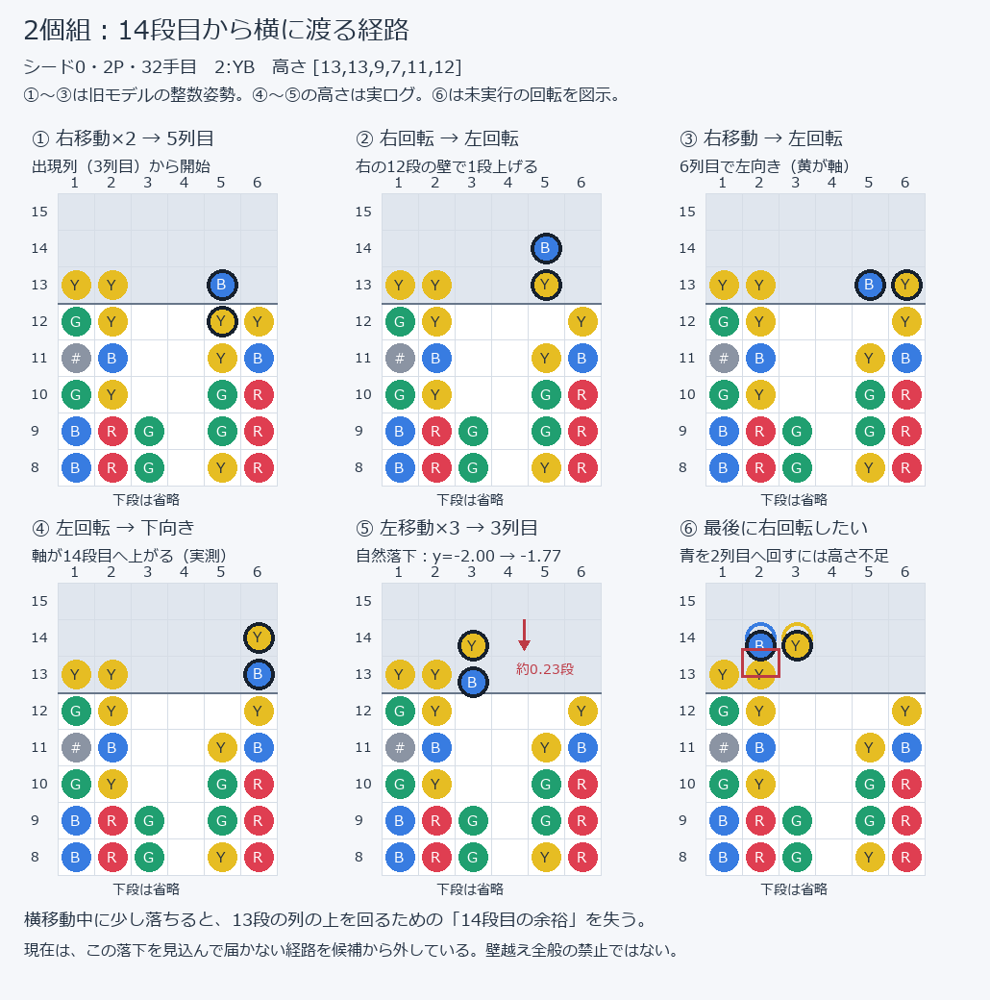

# 2個組に残っている経路制限：14段目からの横移動

これは成功する手順の紹介ではなく、現在の到達モデルが除外している経路の説明。シード0・2P32手目、`2:YB`、高さ `[13,13,9,7,11,12]` の実ログ例。列は1始まり。黄が軸、青が子。

1. 出現列の3列目から右へ2回、5列目へ動く。
2. 右回転で6列目の12段の壁へ引っ掛け、左回転で上向きに戻す。旧モデルでは軸が13段目になる。
3. 右へ1回動いて6列目へ。左回転して子を左にする。
4. もう一度左回転すると、下側の子が壁に当たり、軸が14段目へ上がる。実ログでは軸y=-2.00、子y=-1.00。
5. 左へ3列移動し、3列目へ戻る。その間の自然落下で、実測は軸y=-1.77、子y=-0.77になる。
6. 最後に右回転して青を2列目へ回したいが、そこには13段の列がある。旧モデルは高さを-2のままと見積もった。現在は落下後の占有段を使うため、この経路では14段目の余裕を失うと判定する。

図の①〜③は旧モデルの整数姿勢で、画面の端数位置を忠実に描いたものではない。④〜⑤の高さはログの実測。⑥は回転した場合の干渉を示す仮想図であり、実際に押された回転ではない。輪郭だけの黄・青が「落ちなかった場合の予測位置」、塗りつぶした黄・青が「観測した高さで回した場合」。制御は横移動の結果の照合で断念し、最後の右回転を送っていない。

右端までの上昇や2個組の特殊回転を一律禁止しているわけではない。現在の制限は、足場を離れて横に渡る間の落下によって届かなくなる経路に適用する。

元ログ：`ama-memory-bridge/observations/session-logs/input-session-20261013-210914.log` の `planning`、`steering gave up`。旧DLLの11入力と図の①〜④の姿勢を照合した。再作図：`python tools/render_pair_airborne_route.py`。この説明の作成では操作設定・コード・バイナリを変更していない。
